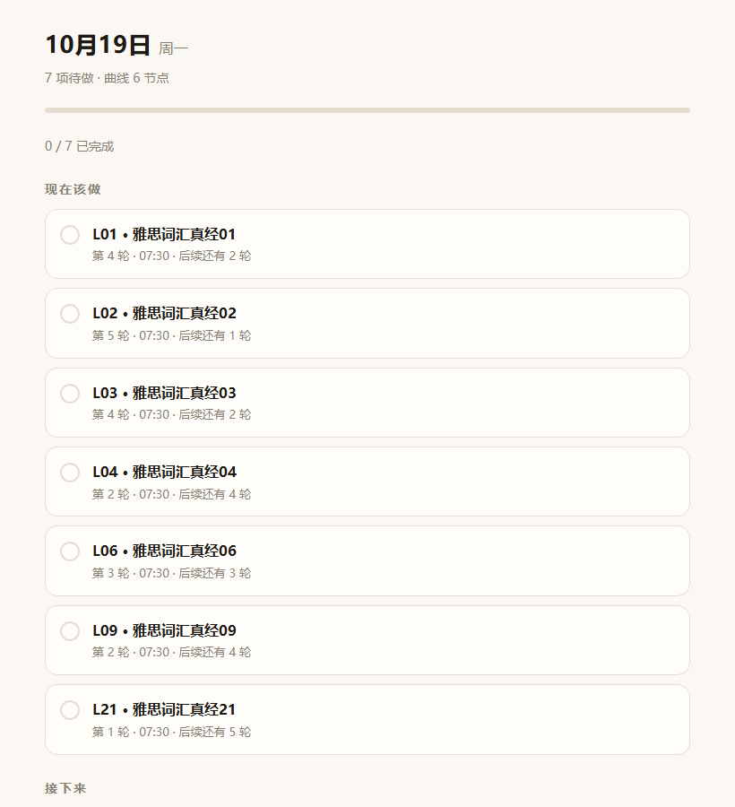

# 词曲线 · vocabcurve

把「原子笔记」里的单词本按**你规定的复习节点**排成时间表：第 1、2、4、7、15、30 天各复习一次，
每天 07:30 提醒你今天该做哪几篇；**第 30 天走完就标记完成，不再提醒**。
词还是在你原来的笔记里背，它只负责排程和提醒。



---

## 一、先说清楚：为什么没接 OpenClaw

你问的那个问题是对的——**接不了**。

OpenClaw 的网关跑在你这台 Windows 上，它的 cron 也跟着网关跑。电脑关机 → 网关没进程 → 07:30 什么都不会发。
这不是配置问题，是本机调度的物理限制；Windows 计划任务同理（只能唤醒睡眠，唤不醒关机）。

所以提醒主路径改成了**不依赖电脑**的方案：

| 方案 | 电脑关机时 | 需要额外准备 |
| --- | --- | --- |
| **① 系统日历（已给你做好，默认走这条）** | ✅ 照常提醒 | 一次性把 `.ics` 导入平板日历 |
| ② GitHub Actions 云端推送 | ✅ 照常推送 | 建个仓库 + 加一个 webhook Secret（3 分钟） |
| ③ 本机计划任务 / OpenClaw cron | ❌ 电脑得开着 | 无 |

原因很简单：**你的曲线是固定的**（第 1/2/4/7/15/30 天），所以未来几个月的每一天在今天就完全确定了。
那就没必要"每天算一次再发一次"——把所有提醒**提前写进日历**，平板本地就能按时弹，电脑关不关无所谓。

`vocabcurve push` 和 `deploy/daily-vocab.yml` 是给方案②准备的，我写好了但没替你建仓库（需要你的 GitHub 账号）。

---

## 二、GitHub 上的现成项目

算法和闪卡类项目很多，但**没有一个是"原子笔记导入 + 我规定的每篇节点 + 系统级提醒"三件套都齐的**：

| 项目 | 它是什么 | 差在哪 |
| --- | --- | --- |
| [lczmx/MemoryCard](https://github.com/lczmx/MemoryCard) | 艾宾浩斯记忆卡片，支持自定义曲线，HTML5 免安装 | 最接近。但卡片在它页面里录入，没有整本单词本导入；也没提日历/推送提醒 |
| [Anki](https://github.com/ankitects/anki) / [AnkiDroid](https://github.com/ankidroid/Anki-Android) + [FSRS](https://github.com/open-spaced-repetition/fsrs4anki) | 最成熟的间隔重复系统 | 间隔是算法算的，不是固定节点；强制固定曲线要手动 Set Due Date / filtered deck，很绕；词还得搬到另一个 App |
| [shettyh/rem](https://github.com/shettyh/rem) | 本地优先 + FSRS-6 + 命令行 + Markdown 卡片 | 工程味最像，但排程模型是它的，不支持"按篇整批排 + 固定节点 + 导出系统日历" |
| [BaiYangbaiyang/kaoyan-vocab](https://github.com/BaiYangbaiyang/kaoyan-vocab) | 考研词汇 + 艾宾浩斯 | 词库内置，导不进自己的单词本 |
| [nuki019/enhanced-flashcard-pwa](https://github.com/nuki019/enhanced-flashcard-pwa) | 艾宾浩斯闪卡 PWA | 自带内容 + 应用内复习，不解决导入和系统提醒 |

> 判断依据是各项目公开的说明（本机访问不了 GitHub 源码页，没能逐个拉下来核对），细节以它们自己的 README 为准。

---

## 三、五分钟上手

需要 Python 3.9+，核心功能零第三方依赖（只有读 `.docx`/`.xlsx` 需要 `python-docx`/`openpyxl`）。

```powershell
cd vocabcurve

# 1. 导入（自动读原子笔记；你的雅思词汇真经 01–22 已经导好了）
.\vv.cmd vivo import --pattern "^雅思词汇真经\d+$" --start 2026-10-20

# 2. 生成今日页 + 日历
.\vv.cmd build

# 3. 每天看
.\vv.cmd today
```

默认参数就是你定的那套：`--intervals 1,2,4,7,15,30`、`--remind 07:30`、`--per-day 1`、`--grid offsets`。
要改的话：

| 参数 | 含义 |
| --- | --- |
| `--start` | 第一篇哪天学，默认今天 |
| `--per-day` | 每天安排几篇新词，默认 1 |
| `--intervals` | 复习节点。**offsets 模式写"第 N 天"**：`1,2,4,7,15,30`；relative 模式写间隔：`30m,12h,1d` |
| `--grid offsets\|relative` | 节点含义。默认 `offsets`（第 N 天） |
| `--remind` | 每天几点提醒，也是"首次学习"的时刻，默认 `07:30` |
| `--merge` | 按标题合并已有 `book.json`，**保留历史打卡**（以后新增篇目用这个） |

---

## 四、单词本怎么进来（平板不用动）

关键发现：你 PC 上装了 **vivo 办公套件**，它已经把原子笔记实时同步到了

```
%APPDATA%\pcsuite\database\NoteSync.db
```

`vocabcurve` 直接只读这个库（连 `-wal` / `-shm` 一起快照，不会锁住正在用的文件），所以**平板不用导出任何东西**：

```powershell
.\vv.cmd vivo list                                # 看有哪些笔记本
.\vv.cmd vivo list --notebook 雅思词汇 --show      # 看这个本里有哪些篇
.\vv.cmd vivo import --pattern "^雅思词汇真经\d+$" --start 2026-10-20
```

已经按这个方式导入了你的 **雅思词汇真经 01–22（22 篇）**；换成本只需改 `--notebook` / `--pattern`，
再带上 `--merge` 就不会丢已打的卡。

### 关于"词"

你这些笔记是**图片笔记**（每页一张照片 + 一层 OCR 文本），OCR 出来的词是糊的（`medium media一intermedia`）。
所以程序只取**篇名**来排程，词表留空——复习时你回原子笔记看原文，打卡记的是"第几篇第几轮"。
这反而更稳：不依赖 OCR，也不会把错词塞进计划。

### 以后想用文本单词本

`import` 也吃 txt / md / csv / xlsx / docx：

```powershell
.\vv.cmd import inbox\words.txt --start 2026-11-01
```

手动导出的备用路子：平板上打开笔记 → 右上角「⋯」→ 分享 / 导出为文本 → 用微信文件传输助手发到电脑。


---

## 五、它认得什么格式

```
第1篇 校园与学习
abandon  v. 放弃；抛弃
academic  adj. 学术的
assume    v. 假定；承担

第2篇 科技与环境
algorithm  n. 算法
carbon     n. 碳
```

- **切篇**：认 `第N篇 / Unit N / List N / Lesson N / Day N / Chapter N`；没有标题时按 `---` 切；
  再没有就按空行块切（每块 ≥ 3 行才算一篇），否则整体算一篇。
- **切词和释义**：按 Tab、两个以上空格、` - `、` — `、`：`、`:`、`，`、`,`、`、` 依次尝试，
  再退一步认「英文 + 单个空格 + 中文」。
- **容错**：`#` / `//` 当注释；`1.`、`(1)`、`1、` 这类序号剥掉；认不出释义的行会保留并在导入时警告。

---

## 六、曲线怎么算

`--intervals 1,2,4,7,15,30` 是「学完第 N 天复习」，全部锚定学习日。第 1 篇 10-20 学：

| 节点 | 日期 | 说明 |
| --- | --- | --- |
| 首次学习 | 10-20 | 也是 30 天曲线的起点 |
| 第 1 轮 | 10-21 | 第 1 天 |
| 第 2 轮 | 10-22 | 第 2 天 |
| 第 3 轮 | 10-24 | 第 4 天 |
| 第 4 轮 | 10-27 | 第 7 天 |
| 第 5 轮 | 11-04 | 第 15 天 |
| 第 6 轮 | 11-19 | 第 30 天 |
| ✅ 完成 | 11-20 | 第 30 天过去，标记完成、**不再产生任何提醒** |

- **完成判定**：6 轮都打卡 → 立即完成；或者最后一个节点过去了 → 也按完成处理（没打的卡会记成"缺 N 个节点"，不骗你）。
- **逾期**：每篇只报最早积压的那一轮，不会一次甩给你 6 个红点。
- **`--mode adaptive`**：把上一轮的实际延误加到本轮上（默认 `strict`，不漂移）。

---

## 七、每天怎么用

**命令行**

```powershell
.\vv.cmd today            # 今天的任务（含逾期、已完成）
.\vv.cmd brief            # 一份纯文本日报，复制发微信也行
.\vv.cmd plan --days 14   # 未来两周
.\vv.cmd curve L03        # 第 3 篇的完整曲线和打卡状态
.\vv.cmd check L03 2      # 打卡：第 3 篇第 2 轮
.\vv.cmd uncheck L03 2    # 点错了
```

**平板浏览器**

```powershell
.\vv.cmd serve --build --host 0.0.0.0 --port 8787
```

电脑和平板同一个 Wi-Fi，平板打开 `http://电脑局域网IP:8787/today.html`。勾选 → 「导出勾选」→
拿回电脑 `.\vv.cmd sync progress-*.json` 写回 `book.json`。

---

## 七点五、从第 16 篇开始、每篇进度不一样

### 1）进度自动读（推荐）

你在每篇第一页写的「日期 + 圈号」（`26.10.3 ① 10.4 ② 10.6 ③ …`）会被收进笔记正文的 OCR 层，
程序直接从里面读：

```powershell
.\vv.cmd scan            # 预演：列出每篇读到的圈号 / 日期 / 推断的轮次
.\vv.cmd scan --apply    # 写回
```

逻辑：最大圈号 = 已完成的最后一轮，最后一个日期 = 那一轮的日子 → 反推学习日，
剩下的节点按 1/2/4/7/15/30 接着排；第一页什么都没读到的按"未开始"处理。

> OCR 不是 100% 准（圈号 ④ 有时被识别成数字 `4`）。`scan` 会打印明细，看到不对的用下面第 2 条改一两个数就行。

### 2）手动微调

```powershell
.\vv.cmd progress                          # 看每篇现在到哪一轮、下次哪天
.\vv.cmd progress 1-15=done                # 前面的篇不再提醒
.\vv.cmd progress 16=2 17=1 18=0 19=-      # 16 已到第 2 轮；17 第 1 轮；18 刚学完；19 未开始
```

| 写法 | 含义 |
| --- | --- |
| `16=2` | 第 16 篇**已完成到第 2 轮**（0 = 只学完首学）。程序反推学习日，让第 2 轮正好落在今天，剩下的节点按 1/2/4/7/15/30 接着走 |
| `16=-` | 未开始，按顺序从明天起一篇篇铺 |
| `1-15=done` | 整篇走完，不再提醒（拉回来用 `1-15=-`） |
| `16=2026-10-12` | 直接指定学习日，其余清空重排 |

### 3）新学顺序：16→22 再 1→15

```powershell
.\vv.cmd order 16-22,1-15
```

只影响**还没开始**的篇怎么排日期，已经开始的篇不受影响。

改完记得 `vocabcurve build`，日历要重导一次。

---

## 八、提醒：怎么做到"电脑关机也能收到"

**① 日历（默认，推荐）**

```powershell
.\vv.cmd ics --days 90 --mode digest
```

`out/vocabcurve.ics` 里就是**未来 90 天每天早上 07:30 的一条事件**，内容形如
「单词复习 · 10月21日 · 2 项：L01 第 1 轮、L02 首次学习」。
发到平板、用日历 App 打开导入即可。之后电脑开着关着都不影响——事件已经在平板本地了。

- 因为曲线固定，这份日历**从生成那天起就是准的**，不需要每天联网重算。
- 加新篇目 / 改曲线 / 补打卡之后重新 `build` 再导一次；建议单独建一个「单词复习」日历，方便整体删了重导。
- `--mode detail` 是每个节点一条事件；你的曲线一天最多一个节点，所以 `digest` 和 `detail` 差不多，默认用 `digest` 更清爽。

**② 云端推送（微信，电脑关机照发）**

```powershell
.\setup-cloud.ps1 -RepoUrl "https://github.com/你的用户名/vocabcurve.git"
```

脚本会初始化 git、把仓库推上去、放好 workflow，然后告诉你最后两步（建 Secret + 手动跑一次）。
完整的图文步骤——包括企业微信群机器人 / Server酱 / ntfy 三种地址怎么拿——见
[deploy/README-cloud.md](deploy/README-cloud.md)。

本地也能手动推，用来验证地址对不对：

```powershell
.\vv.cmd push --url "https://qyapi.weixin.qq.com/cgi-bin/webhook/send?key=xxx" --format wecom
.\vv.cmd push --dry-run          # 只看内容，不发
```

**③ 本机定时（不推荐）**

Windows 计划任务 / OpenClaw cron 都能做，但都要电脑开着。真要用，`out/brief.txt` 就是现成的消息内容。

---

## 九、命令速查

| 命令 | 作用 |
| --- | --- |
| `vivo list [--notebook X] [--pattern Y] [--show]` | 看原子笔记里有哪些笔记本 / 篇（读 PC 同步库） |
| `vivo import [--notebook X] [--pattern Y] [--merge]` | 按笔记批量生成篇目 |
| `import <文件> [--merge]` | 导入/合并单词本，生成 `book.json` |
| `scan [--apply]` | 从笔记第一页的日期+圈号自动读每篇进度 |
| `order 16-22,1-15` | 设定新学顺序 |
| `progress [16=2 …]` | 看/改每篇的复习进度（从第几篇开始、各自到第几轮） |
| `today [--at 时间] [--json]` | 今日任务（含逾期和已完成） |
| `brief [--at]` | 纯文本日报（给推送用） |
| `push --url ... --format wecom\|serverchan\|ntfy\|json` | 推送到 webhook |
| `plan [--days N]` | 未来 N 天的时间表 |
| `curve [篇号]` | 某篇（或全部）的完整曲线 |
| `check / uncheck <篇号> <轮次>` | 打卡 / 撤销 |
| `sync <progress.json>` | 把网页上勾的写回 `book.json` |
| `build [--out 目录]` | 生成 today.md / today.html / plan.md / brief.txt / .ics |
| `ics [--days N] [--mode digest\|detail\|both]` | 只生成日历 |
| `serve [--build] [--host 0.0.0.0]` | 起本地页面服务 |
| `info` | 看当前配置 |

---

## 十、目录结构

```
vocabcurve/
├─ vocabcurve/
│  ├─ model.py          # 数据模型 + book.json 原子读写
│  ├─ parse.py          # 单词本解析（txt/md/csv/xlsx/docx）
│  ├─ vivo.py           # 只读 vivo 办公套件的 NoteSync.db，直接拿原子笔记
│  ├─ schedule.py       # 曲线排程 + 今日任务 + 逾期 + 完成判定
│  ├─ ics.py            # .ics 生成（RFC 5545，含 VTIMEZONE 和折行）
│  ├─ render.py         # Markdown / HTML 渲染
│  └─ __main__.py       # 命令行
├─ tests/               # 69 个单元测试
├─ deploy/daily-vocab.yml   # GitHub Actions 云端推送模板
├─ deploy/README-cloud.md   # 云端微信推送的完整步骤
├─ setup-cloud.ps1      # 一键推仓库
├─ inbox/sample.txt     # 示例单词本（文本导入用）
├─ out/                 # 生成物（已 gitignore）
├─ vv.cmd               # Windows 启动器
└─ book.json            # 你的数据（云端方案需要提交）
```

---

## 十一、测试与边界

```powershell
python -m unittest discover -s tests -t . -v
```

69 个测试覆盖：解析各种分隔符和切篇、间隔与天数换算、offsets/relative 两种网格、
strict/adaptive、逾期只报一轮、**第 30 天后自动完成且不再产生任务**、打卡与撤销、
原子笔记读取（选题/排序/图片笔记只留篇名）、`.ics` 的 CRLF / 75 字节折行 / 转义 / UTC DTSTAMP，
以及整条 CLI 链路。

已知边界：

- **原子笔记的图片笔记没有可靠文本**，只按篇排程；要按词追踪得先有文本单词本。
- **.ics 是快照**，不是订阅源；改计划后重新生成再导入。
- 时间按 `Asia/Shanghai` 生成；换时区改 `settings.timezone`，非中国时区退化成"浮动时间"。
- 只排"篇"，不排"词"：复习单位就是一篇，不单独追踪每个词的掌握度。
- GitHub Actions 的定时会延迟 5–15 分钟，07:25 触发通常 07:30 前后到。
- 不支持图片/语音词卡（原子笔记里的富文本会被压平成纯文字）。
